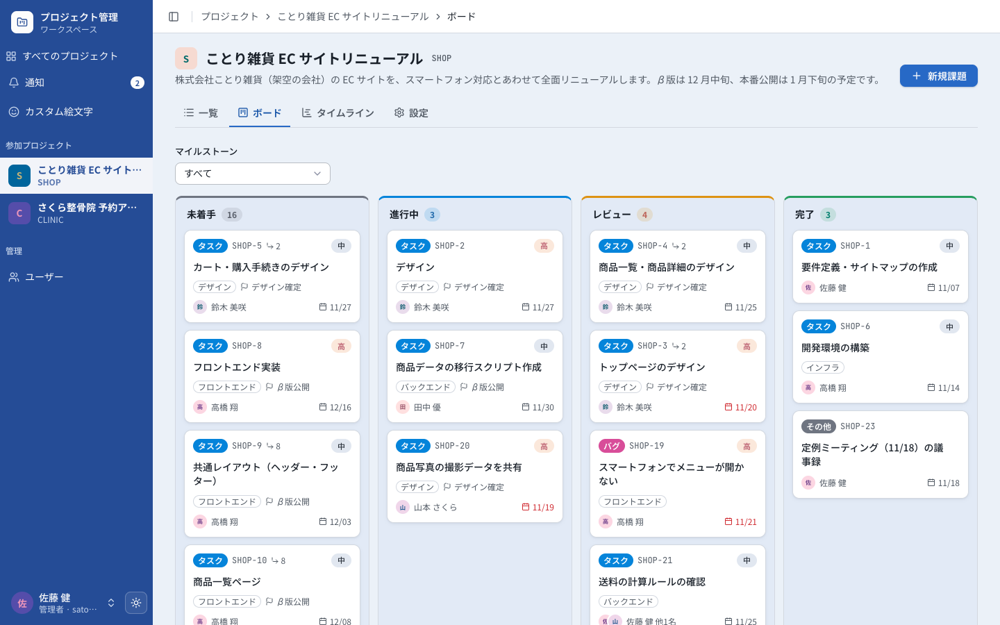
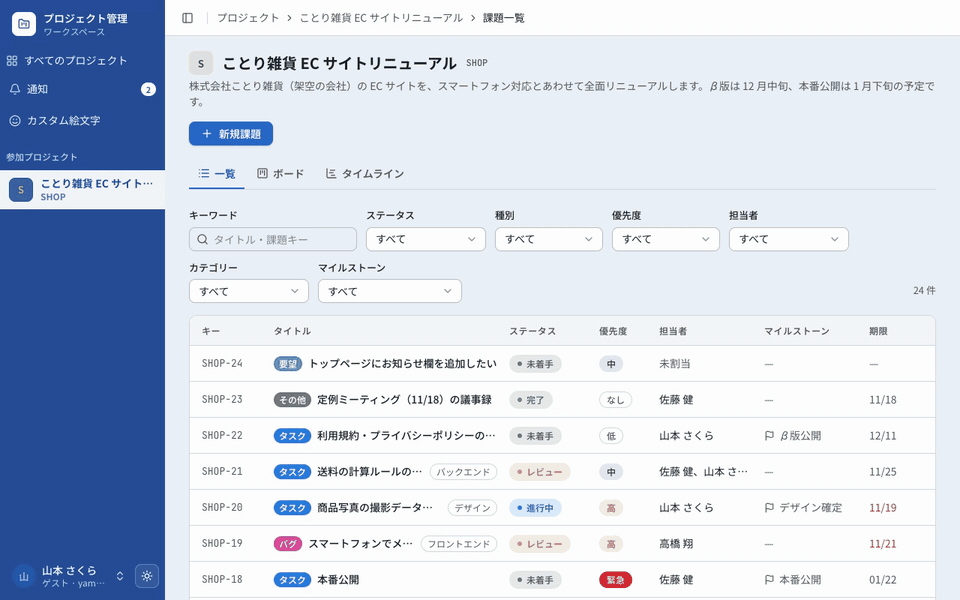
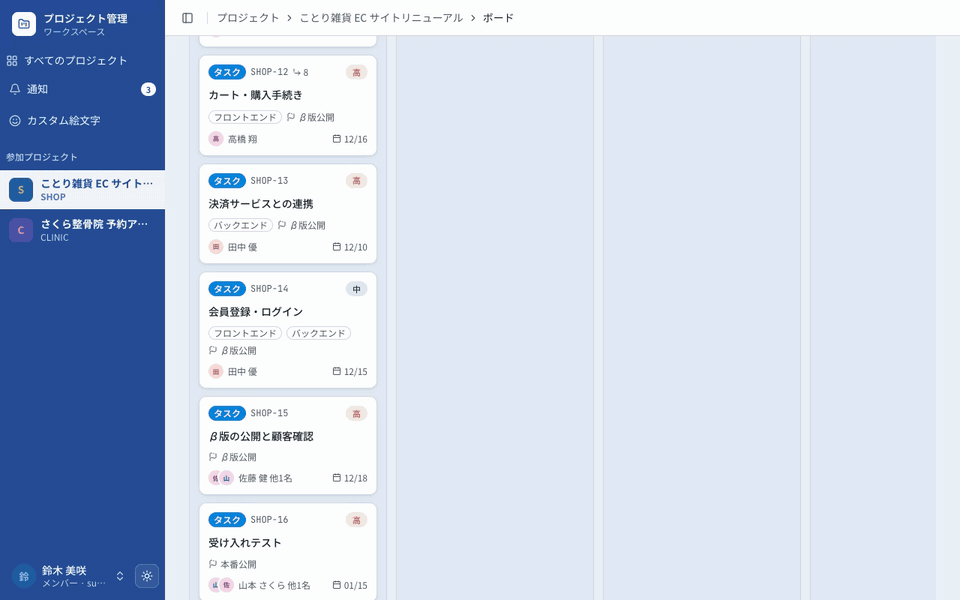
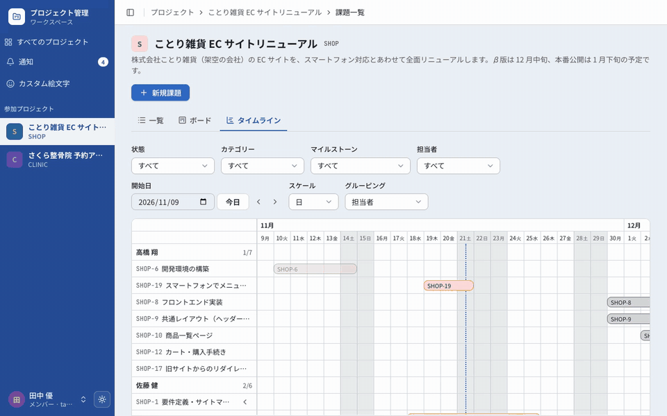
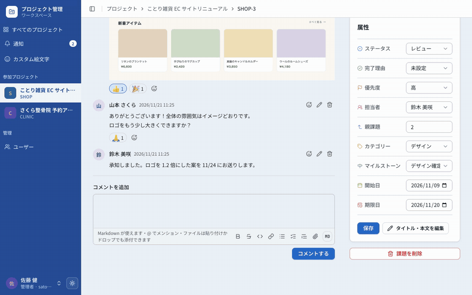
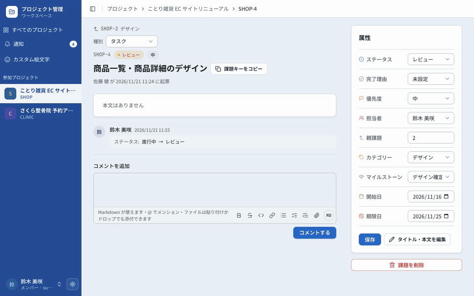
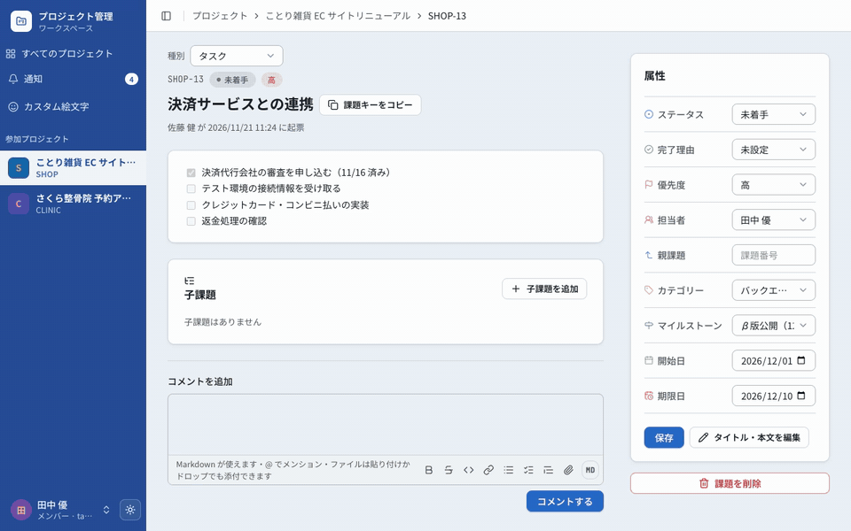

# Project Manager

受託開発会社と顧客（ゲスト）が課題を共有するための、セルフホスト型プロジェクト管理ツールです。Cloudflare Workers と D1 で動きます。

- 課題管理（番号・ステータス・種別・優先度・複数の担当者・開始日と期限・カテゴリー・マイルストーン・1 階層のサブタスク）、絞り込みと編集履歴
- カンバンとタイムライン（ガントチャート。バーのドラッグで日程を変更）
- 見たまま編集できる Markdown エディタ（表、ファイルの貼り付け、`@` メンション、課題キー `PROJ-12` の自動リンク）と添付ファイル
- コメントへの絵文字リアクション（カスタム絵文字も登録できる）
- 担当の割り当て・ステータスの変更・コメント・メンションの通知（アプリ内と Slack の DM）
- 顧客をゲストとして招待し、参加プロジェクトだけを見せる。見せるだけの相手は閲覧者として招待できる（起票・編集・コメント不可）
- REST API と Claude Code 用の Skill

**利用には Cloudflare アカウントが必要です。Workers の無料プランで動きます。** 手順は[ドキュメント](https://project-manager-docs.hirano-i.workers.dev)（ソースは `apps/docs`）を参照してください。



## デモ

[https://project-manager.hirano-i.workers.dev](https://project-manager.hirano-i.workers.dev) で実際の画面を見られます。プロジェクト、メンバー、課題はすべて架空のものです。

- メールアドレス: `demo@example.com`
- パスワード: `pm-demo-2026`

> [!NOTE]
> デモのアカウントは閲覧専用（閲覧者ロール）です。課題の起票・編集、ステータスの変更、コメントとリアクション、ファイルの添付、カンバンやタイムラインのドラッグはできません。これらの操作は、下の画面イメージか[ドキュメントのデモのページ](https://project-manager-docs.hirano-i.workers.dev/guides/demo/)を参照してください。

<details>
<summary>デモでは試せない操作の画面イメージ</summary>

**課題の起票**（顧客のゲストも起票できます）



**カンバンでのステータス変更**



**タイムラインでの日程変更**



**コメント・メンション・リアクション**



**ファイルの添付**



**子課題の追加**



</details>

## 開発

```bash
mise install && pnpm install
pnpm docs:dev   # ドキュメント
pnpm dev        # アプリ（事前に apps/web で .dev.vars の用意と pnpm db:migrate:local が必要）
```

Issue や Pull Request の送り方は [CONTRIBUTING.md](CONTRIBUTING.md) を参照してください。脆弱性は公開の Issue にせず、[SECURITY.md](SECURITY.md) の手順で報告してください。

## 外部 API と AI エージェント

REST API（`/api/v1`）で、課題の一括起票やスケジュール作成、一括修正ができます。Claude Code 用の Skill も同梱しています。エンドポイントと項目は [`skills/project-manager/reference.md`](skills/project-manager/reference.md) を参照してください。

1. API キーを発行します。管理者でログインし、アカウント設定の「API キー」カードで作成します（管理者だけが使えます）。平文は発行直後に一度しか表示されません。
2. Skill を導入します。

   ```bash
   cp -r skills/project-manager ~/.claude/skills/
   ```

3. 環境変数を設定します。

   ```bash
   export PM_API_URL="https://<デプロイした URL>"
   export PM_API_KEY="pm_..."
   ```

Claude Code で「このスケジュールをプロジェクトに登録して」のように頼むと、Skill が一覧の確認を取ったうえで一括起票します。

## ライセンス

MIT
